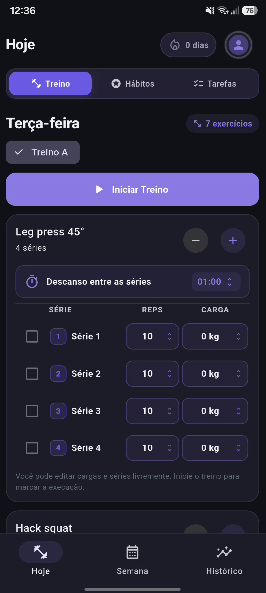
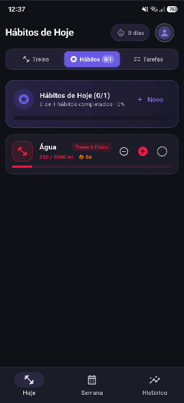
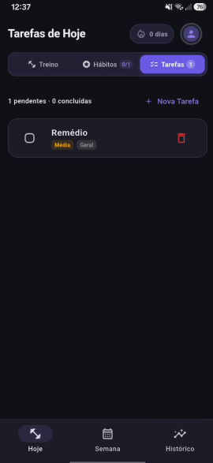
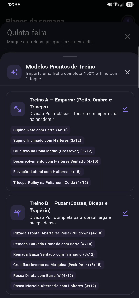
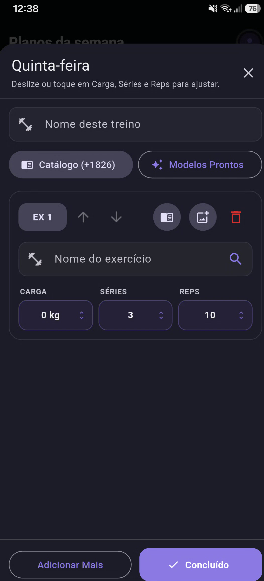
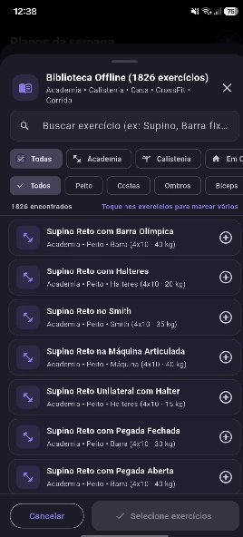
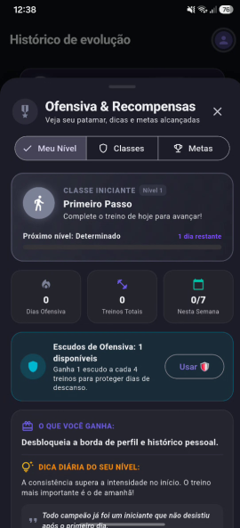
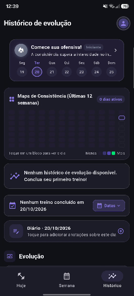
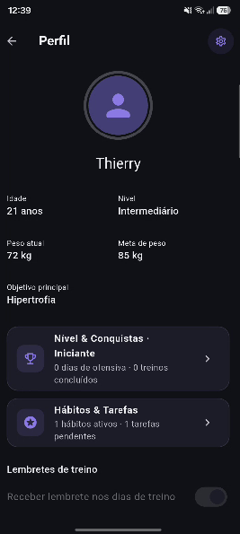

<div align="center"> 
  


# Offline Gym

### Seu treino organizado. Seus registros no seu aparelho. Sem depender de internet.

O **Offline Gym** é um aplicativo completo e multiplataforma (Android e iOS) para planejar treinos, registrar séries e cargas, acompanhar hábitos e tarefas diárias, e monitorar sua evolução corporal com inteligência biomecânica — **100% gratuito, sem anúncios e com funcionamento offline nativo**.

**Versão do Projeto:** `v1.4.1` (Código de Compilação `8`).

[🤖 Baixar para Android (.apk)](https://github.com/LuanThierry/offline-gym/releases/latest/download/Offline-Gym.apk) · [🍎 Baixar para iPhone (.ipa)](https://github.com/LuanThierry/offline-gym/releases/latest/download/Offline-Gym-iOS.ipa) · [Ver Versões Anteriores](https://github.com/LuanThierry/offline-gym/releases) · [Código-fonte](https://github.com/LuanThierry/offline-gym) · [Política de Privacidade](PRIVACY_POLICY.md)

<hr>

## 🔐 Assinatura, privacidade e publicação

O repositório não deve conter `android/key.properties`, `.jks`, `.keystore`,
senhas, tokens ou arquivos de backup reais. O release Android falha de propósito
quando `android/key.properties` não existe; isso impede que um APK de produção
seja assinado acidentalmente com a chave de debug.

Para build local do Android, mantenha a chave fora do Git e configure `android/key.properties`
ou use as variáveis de ambiente (`ANDROID_KEYSTORE_PATH`, `ANDROID_KEY_ALIAS`, `ANDROID_KEY_PASSWORD`, `ANDROID_STORE_PASSWORD`).
No GitHub Actions, o workflow executa a validação do código (`flutter analyze` e `flutter test`) e
gera exclusivamente o pacote iOS (`.ipa` não assinado, destinado a sideload pessoal via Sideloadly ou AltStore).

O app é offline-first: dados de treino, saúde e backups ficam no armazenamento
privado do app e o Android Backup está desativado. O backup local automático é
destinado ao sandbox do próprio app; para transportar um backup, use a exportação
protegida por senha.


</div>

---

## ⚡ Resumo Rápido (Para quem não quer ler tudo)

> **O que é o Offline Gym em poucas palavras:**  
> Um aplicativo para levar para a academia que **não precisa de internet**, não pede cadastro nem login, **não tem anúncios** e calcula suas cargas, descansos, hábitos diários e simetria muscular direto no seu celular.

### 📥 Links Diretos de Download:

- **Para celulares Android:** [Baixar `Offline-Gym.apk`](https://github.com/LuanThierry/offline-gym/releases/latest/download/Offline-Gym.apk) _(Basta baixar, tocar no arquivo e instalar)_.
- **Para iPhone (iOS):** [Baixar `Offline-Gym-iOS.ipa`](https://github.com/LuanThierry/offline-gym/releases/latest/download/Offline-Gym-iOS.ipa) _(Consulte o passo a passo ilustrado abaixo usando o programa gratuito Sideloadly)_.

---

### ⚠️ Importante para quem já utiliza uma versão anterior

A partir da versão **1.1.0**, o Offline Gym utiliza um novo identificador e assinatura própria. Caso você já utilize uma versão muito antiga, faça o seguinte para não perder seus treinos:

1. Abra o Offline Gym antigo e vá em **Configurações → Exportar backup**.
2. Guarde o arquivo `.ogb` em um local seguro (WhatsApp, Drive ou pasta pessoal).
3. Instale o novo Offline Gym.
4. No novo aplicativo, vá em **Configurações → Importar backup** e recupere tudo com 1 clique!

[⭐ Apoiar a iniciativa com uma estrela no GitHub](https://github.com/LuanThierry/offline-gym) · [💖 Apoiar o criador via LivePix (PIX)](https://livepix.gg/luanthierry)

---

## 📱 Como Baixar e Instalar no seu iPhone (Guia Simples para Leigos)

Diferente do Android, a Apple não permite que aplicativos sejam baixados diretamente do navegador Safari sem passar pela App Store oficial. Porém, existe uma forma **100% gratuita, oficial e segura** chamada _Sideloading_ (instalação pessoal autorizada pela própria Apple).

O arquivo de instalação do iPhone é o **`.ipa`** (que é o equivalente ao `.apk` do Android).

### 🚀 Método 1: No Windows ou macOS (Com o programa gratuito Sideloadly)

Este é o método mais fácil e recomendado para quem usa computador com Windows ou Mac:

1. **Baixe o arquivo do aplicativo:**  
   No seu computador ou celular, baixe o arquivo [**`Offline-Gym-iOS.ipa`**](https://github.com/LuanThierry/offline-gym/releases/latest/download/Offline-Gym-iOS.ipa).
2. **Instale o Sideloadly no seu computador:**  
   Acesse o site oficial [sideloadly.io](https://sideloadly.io/) e baixe a versão para Windows ou Mac. Instale e abra o programa.
3. **Conecte seu iPhone no computador:**  
   Plugue o iPhone no computador usando o cabo USB (o mesmo do carregador). Se o iPhone perguntar _"Confiar neste computador?"_, toque em **Confiar** e digite o código de desbloqueio da tela.
4. **Instale o app pelo Sideloadly:**
   - Arraste o arquivo `Offline-Gym-iOS.ipa` para dentro da tela do Sideloadly.
   - No campo **Apple ID**, digite o seu e-mail da Apple (o mesmo que você usa no iPhone).
   - Clique no botão verde **Start**. (O Sideloadly pedirá sua senha da Apple apenas para assinar o app diretamente nos servidores da Apple com seu perfil gratuito de usuário).
   - Aguarde aparecer a mensagem **Done!** (o ícone do Offline Gym aparecerá na tela do seu iPhone).
5. **Autorize o app a abrir no iPhone (Apenas no primeiro uso):**
   - No seu iPhone, abra o aplicativo **Ajustes** (Configurações).
   - Vá em **Geral → Gestão de VPN e Dispositivos** (ou _Gerenciamento de Dispositivos_).
   - Toque no seu e-mail Apple que aparece na lista e clique em **"Confiar em [Seu E-mail]"**.
   - _(Se o seu iPhone estiver no iOS 16 ou superior)_: Vá em **Ajustes → Privacidade e Segurança**, role até o fim da página, toque em **Modo Desenvolvedor** e ative-o (o iPhone reiniciará uma vez).
6. **Pronto!** O Offline Gym está pronto para abrir e usar na academia com zero internet!

---

### 🐧 Método 2: No Linux (Ubuntu, Debian, Fedora, Arch, Pop!\_OS, Mint)

Se o seu computador roda Linux, você também pode assinar e instalar o `Offline-Gym-iOS.ipa` no seu iPhone de forma 100% gratuita usando ferramentas de terminal open-source:

#### Passo 1: Instale o suporte a USB do iPhone no Linux

Abra o terminal da sua distribuição Linux e instale o pacote `usbmuxd` (serviço que comunica o Linux com dispositivos iOS):

```bash
# No Ubuntu, Debian, Pop!_OS e Linux Mint:
sudo apt update && sudo apt install -y usbmuxd libimobiledevice6 libimobiledevice-utils

# No Fedora e RHEL:
sudo dnf install -y usbmuxd libimobiledevice libimobiledevice-utils

# No Arch Linux e Manjaro:
sudo pacman -S usbmuxd libimobiledevice
```

Inicie o serviço de conexão USB:

```bash
sudo systemctl start usbmuxd
```

#### Passo 2: Conecte o iPhone e emparelhe

Conecte o iPhone na porta USB. Desbloqueie a tela do iPhone, toque em **"Confiar neste computador"** e execute no terminal:

```bash
idevicepair pair
```

_(Deve exibir uma mensagem de sucesso: `SUCCESS: Paired with device ...`)_.

#### Passo 3: Assine e instale com o AltServer-Linux

1. Baixe o [**AltServer-Linux** (Release oficial do NyaMisty)](https://github.com/NyaMisty/AltServer-Linux/releases) no seu Linux.
2. Baixe o arquivo [**`Offline-Gym-iOS.ipa`**](https://github.com/LuanThierry/offline-gym/releases/latest/download/Offline-Gym-iOS.ipa).
3. Dê permissão de execução e instale no iPhone:

```bash
chmod +x AltServer-x86_64
./AltServer-x86_64 -u $(idevice_id -l) -a seu-email@apple.com -p sua-senha Offline-Gym-iOS.ipa
```

O aplicativo será assinado pelo seu Apple ID gratuito e instalado instantaneamente no seu iPhone!

---

### 📲 Método 3: Direto pelo próprio iPhone (Sem precisar de PC toda semana)

- **Se você já utiliza o [SideStore](https://sidestore.io/) ou [AltStore](https://altstore.io/):**  
  Basta baixar o arquivo [**`Offline-Gym-iOS.ipa`**](https://github.com/LuanThierry/offline-gym/releases/latest/download/Offline-Gym-iOS.ipa) pelo Safari no iPhone, tocar no arquivo baixado e selecionar **"Abrir com SideStore / AltStore"**. O app será assinado e instalado direto no celular via Wi-Fi!
- **Se você utiliza o [TrollStore](https://github.com/opa334/TrollStore) (iOS compatíveis):**  
  Basta baixar o `.ipa` no Safari e tocar em **"Install with TrollStore"**. O app fica instalado para sempre, sem limite de 7 dias e sem precisar assinar novamente.

> 💡 **Dica de Ouro:** Para quem instala com o Apple ID gratuito (Métodos 1 e 2), a Apple concede 7 dias de assinatura. Ao final de 7 dias, basta reconectar o iPhone e clicar em "Start" (ou rodar o comando) novamente para renovar — todos os seus treinos, dados e histórico permanecem 100% salvos e intactos!

---

## 🤖 Como Baixar e Instalar no Android

1. Abra a página de [Releases](https://github.com/LuanThierry/offline-gym/releases).
2. Baixe o arquivo [**`Offline-Gym.apk`**](https://github.com/LuanThierry/offline-gym/releases/latest/download/Offline-Gym.apk).
3. Abra o arquivo baixado no seu celular. Se o Android perguntar se você autoriza a instalação de fontes desconhecidas do seu navegador/gerenciador de arquivos, toque em **Permitir**.
4. Toque em **Instalar** e abra o Offline Gym!

---

## ✨ Recursos e Funcionalidades (v1.4.1)

### 🧠 Inteligência Própria & Fisiologia do Exercício

- **Coach Científico & Fisiológico Offline:** analisa proporções musculares e assimetrias anatômicas (como a relação entre Isquiotibiais e Quadríceps para proteger os ligamentos do joelho, ou a proporção entre Peito e Costas para postura). Tudo calculado localmente em milissegundos sem enviar nada para servidores externos.
- **Estimativa de Fadiga e Recuperação Muscular por Músculo (Microciclo):** O Coach monitora o intervalo em horas desde a última sessão de cada grupamento (ex.: Peitoral 90% recuperado, Pernas 35% em recuperação ativa), exibindo barras de progresso dinâmicas e alertando sobre risco de sobrecarga caso você tente treinar o mesmo músculo antes do tempo biológico ótimo de descanso.
- **Gráfico Radar de Simetria Muscular:** visualização em teia de 6 eixos comparando seu volume real de treino com a literatura científica de hipertrofia (MEV, MAV e MRV).
- **Rampa de Aquecimento Inteligente (Warm-up com 1-Toque):** calcula e injeta séries preparatórias graduais (40%, 60%, 80%) para preparar suas articulações sem cansar o músculo antes das séries pesadas.
- **Semana de Deload com 1-Toque:** reduz automaticamente 40% do volume das rotinas para permitir que seus tendões e sistema nervoso central descansem e se recuperem após semanas de treino intenso.

### 🎨 Personalização de Temas & Tela AMOLED

- **Modo Preto Puro AMOLED (#000000):** desliga completamente os pixels pretos em telas OLED/AMOLED, economizando o máximo de bateria durante o treino.
- **6 Estilos Esportivos com Cores Isoladas:** Roxo Clássico, Foco Bestial (Esmeralda), Sangue & Ferro (Vermelho), Ouro Campeão (Dourado), Cyber Neon (Ciano) e Obsidiana Stealth (Grafite). Todas as cores de botões, gráficos e cartões mudam em harmonia.
- **Intensidade Háptica Tátil Configurável:** escolha a intensidade da vibração do celular (Forte, Média ou Desativada) ao alternar séries, tocar em botões e concluir exercícios.

### 🏋️‍♂️ Biblioteca e Execução do Treino

- **Mais de 2.000 Exercícios 100% Offline com Isolate em Background:** catálogo ultra-rápido com filtragem assíncrona concorrente via `compute()`, mantendo 120 FPS cravados e resposta imediata sem engasgos durante a digitação.
- **Padronização Visual de Séries, Reps e Cargas:** botão único e refinado (`reps • kg`) com acionamento do seletor deslizante Cupertino magnético, eliminando conflitos de gestos de arrasto horizontal com a rolagem vertical da tela.
- **15 Modelos Prontos de Treino:** ABC, Upper/Lower, Glúteos, Calistenia, WOD, Powerlifting 5x5, Treino em Casa, Mobilidade, Lutas e Pilates.
- **Calculadora de Cargas e 1RM:** fórmulas combinadas de Epley e Brzycki para estimar sua carga máxima de 1 repetição e porcentagens para séries de força e hipertrofia.
- **Calculadora de Anilhas por Lado da Barra (20 kg):** descubra na hora quais anilhas colocar de cada lado da barra olímpica para atingir o peso alvo.
- **Marcadores de Séries:** defina cada série como **Normal**, **Aquecimento (`A`)**, **Drop-set (`D`)** ou **Falha Muscular (`F 🔥`)**, além de agrupar exercícios em **Bi-sets / Super-séries**.
- **Contagem Regressiva Sonora 3-2-1:** bips sonoros e vibração nos últimos 3 segundos do tempo de descanso para você se posicionar na máquina sem precisar ficar olhando para o celular.

### 🥗 Nutrição, Medidas e Evolução

- **Exportação de Fichas e Relatórios em PDF Nativo e CSV (Sem Depender de Nuvem ou WebView):** gere diretamente no aparelho a **Ficha Semanal de Treinos** (na aba Planos) ou o **Relatório Executivo para Personal/Nutricionista** (na aba Histórico) em formato binário PDF diagramado em alta resolução ou planilha CSV, prontos para impressão ou compartilhamento via WhatsApp.
- **Calculadora Nutricional TMB / TDEE:** cálculo da sua Taxa Metabólica Basal pela equação Mifflin-St Jeor, meta de calorias diárias ajustada pelo seu objetivo (Emagrecimento, Hipertrofia ou Manutenção), divisão de proteínas, carboidratos e gorduras, e meta diária de água.
- **Registro de Medidas com Fita Métrica:** acompanhamento de braço, peitoral, cintura, abdômen, coxas e panturrilhas, com comparação automática de centímetros ganhos ou perdidos.
- **Comparador Visual de Fotos "Antes & Depois":** compare sua evolução corporal com divisor interativo deslizante em tempo real ou lado a lado com zoom.

---

## 📸 Demonstração Visual

<div align="center">
  
</div>

<table align="center">
  <tr>
    <td align="center" width="33%">
      <br>
      <sub><b>Hoje · Treino & Cargas</b><br>Séries, repetições, tipo e cronômetro</sub>
    </td>
    <td align="center" width="33%">
      <br>
      <sub><b>Hoje · Hábitos Diários</b><br>Meta de água em mL, ofensiva e progresso</sub>
    </td>
    <td align="center" width="33%">
      <br>
      <sub><b>Hoje · Tarefas To-Do</b><br>Checklist diário com prioridades</sub>
    </td>
  </tr>
  <tr>
    <td align="center" width="33%">
      <br>
      <sub><b>15 Modelos Prontos</b><br>ABC, Upper/Lower, Glúteos, Calistenia e mais</sub>
    </td>
    <td align="center" width="33%">
      <br>
      <sub><b>Planos da Semana</b><br>Rotinas diárias e dias de descanso</sub>
    </td>
    <td align="center" width="33%">
      <br>
      <sub><b>Biblioteca (+2.000 Exercícios)</b><br>Filtros por modalidade e adição em lote</sub>
    </td>
  </tr>
  <tr>
    <td align="center" width="33%">
      <br>
      <sub><b>Gamificação & Ofensiva</b><br>Escudos de descanso (🛡️), 10 classes e metas</sub>
    </td>
    <td align="center" width="33%">
      <br>
      <sub><b>Histórico & Heatmap</b><br>Calendário e mapa de consistência de 12 semanas</sub>
    </td>
    <td align="center" width="33%">
      <br>
      <sub><b>Perfil do Usuário</b><br>Foto, medidas, peso, metas e conquistas</sub>
    </td>
  </tr>
</table>

---

## 🛠️ Seção Técnica: Arquitetura, Engenharia e Compilação

Esta seção detalha as escolhas de engenharia, arquitetura de software e automação de compilação do projeto.

### 🏛️ Estrutura Arquitetural

O projeto adota princípios pragmáticos de **Clean Architecture** com separação explícita de responsabilidades em camadas desacopladas:

```text
lib/
├── banco_dados/    # Camada de Persistência SQLite nativa (DatabaseHelper, migrações e índices)
├── modelos/        # Data Transfer Objects (DTOs) com serialização/desserialização JSON e Map
├── dominio/        # Regras de negócio puras (Coach fisiológico, volume muscular, gamificação)
├── servicos/       # Serviços locais do dispositivo (Áudios sintetizados, criptografia, backups)
├── provedores/     # Gerenciamento de estado reativo unificado via Provider (ChangeNotifier)
├── componentes/    # Widgets reutilizáveis, modais, gráficos de radar e seletores customizados
├── telas/          # Views estruturadas das abas principais e fluxos de navegação
└── main.dart       # Ponto de entrada, injeção de dependências e configuração de temas
```

### 🔒 Persistência e Segurança Criptográfica

- **Armazenamento Primário:** Banco de dados relacional SQLite nativo via `sqflite`, com índices compostos em chaves estrangeiras (`id_treino_historico`, `id_exercicio`, `data_iso`).
- **Criptografia Autenticada de Backups:** Backups `.ogb` são gerados utilizando o pacote `cryptography`:
  - **KDF:** Derivação de chave segura com **Argon2id** (memória: 64 MB, iterações: 3, salt criptográfico aleatório de 16 bytes via CSPRNG).
  - **Cifra:** **AES-256-GCM** com vetor de inicialização (IV) de 12 bytes e tag de autenticação de integridade de 16 bytes, prevenindo adulterações e ataques _padding oracle_.

### 📊 Algoritmos e Biomecânica Computacional

- **Estimativa de Força Máxima (1RM):** Fórmulas combinadas de **Epley** $\text{1RM} = w \cdot (1 + \frac{r}{30})$ e **Brzycki** $\text{1RM} = w \cdot \frac{36}{37 - r}$ para suavização de dispersão estatística em repetições entre 1 e 12.
- **Proporção Isquiotibiais vs Quadríceps (Razão I:Q):** Avaliação biomecânica do torque flexor/extensor com limiar ótimo de segurança articular $\ge 0.60$ para prevenção de lesões de ligamento cruzado anterior (LCA).
- **Taxa Metabólica Basal (TMB):** Equação **Mifflin-St Jeor** ponderada por sexo, peso, altura e idade, multiplicada por fatores de atividade física validados pela literatura de fisiologia do esporte.

## 🛡️ Segurança, Privacidade e Seus Dados

- **Zero rastreamento:** O aplicativo não inclui Firebase Analytics, Google Ads, Crashlytics ou qualquer biblioteca de telemetria.
- **Sem servidores intermediários:** Seus dados nunca saem do seu aparelho sem sua ação explícita de exportar um backup.
- **Isolamento de permissões:** O aplicativo não solicita permissão de acesso à internet nos manifestos do Android e iOS. As permissões de Galeria e Câmera são opcionais e solicitadas apenas se você decidir tirar fotos de evolução.

---

### 🤝 Agradecimentos e Ferramentas Open-Source

A distribuição gratuita da versão iOS e a compatibilidade multiplataforma com Linux são viabilizadas pelo trabalho de projetos abertos da comunidade aos quais deixamos nosso reconhecimento:

- [**libimobiledevice**](https://libimobiledevice.org/) & [**usbmuxd**](https://github.com/libimobiledevice/usbmuxd) — bibliotecas fundamentais que permitem ao Linux comunicar com o iPhone via USB.
- [**AltServer-Linux (NyaMisty)**](https://github.com/NyaMisty/AltServer-Linux) & [**SideStore**](https://sidestore.io/) — ferramentas que tornam possível assinar pacotes `.ipa` em distribuições Linux e direto no iPhone sem fios.
- [**Sideloadly**](https://sideloadly.io/) — solução descomplicada para instalação pessoal no Windows e Mac.
- [**subosito/flutter-action**](https://github.com/subosito/flutter-action) — automação de compilação multiplataforma no GitHub Actions.

---

## 👤 Criador, Autoria e Licença

- **Criador e Desenvolvedor:** **Luan Thierry** ([@LuanThierry](https://github.com/LuanThierry))
- **Como Apoiar:** Se o aplicativo ajuda nos seus treinos e rotina diária, considere apoiar voluntariamente o projeto pelo [**LivePix (`livepix.gg/luanthierry`)**](https://livepix.gg/luanthierry) ou deixando uma **Estrela (⭐)** aqui no GitHub!

O código-fonte está licenciado sob a licença [MIT](LICENSE). Consulte [`docs/LICENCA_E_DADOS.md`](docs/LICENCA_E_DADOS.md) para detalhes sobre dados locais, backups e chaves de compilação.

---

<div align="center">
  <b>Offline Gym</b> — Feito por quem treina, para quem treina. 💪
</div>
