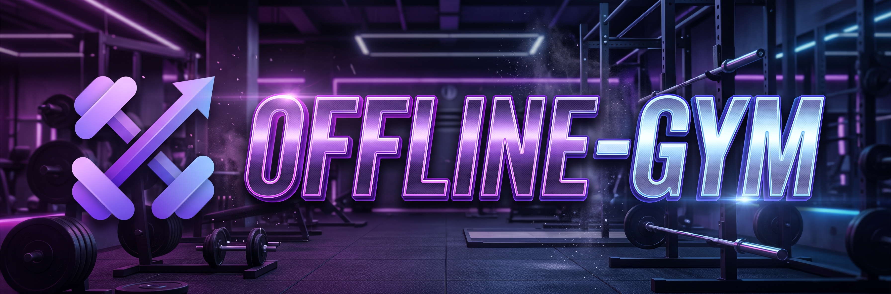
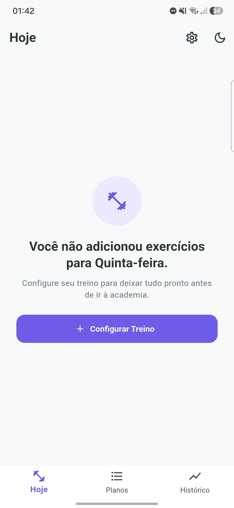
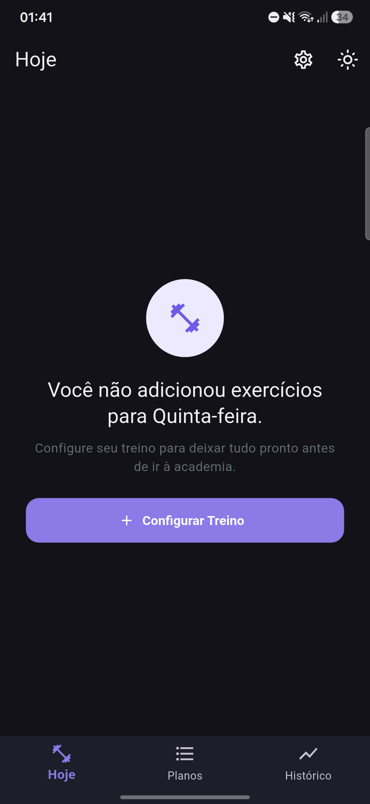
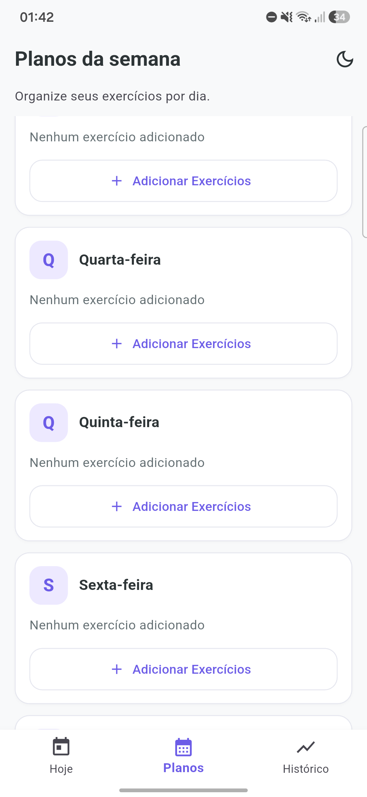
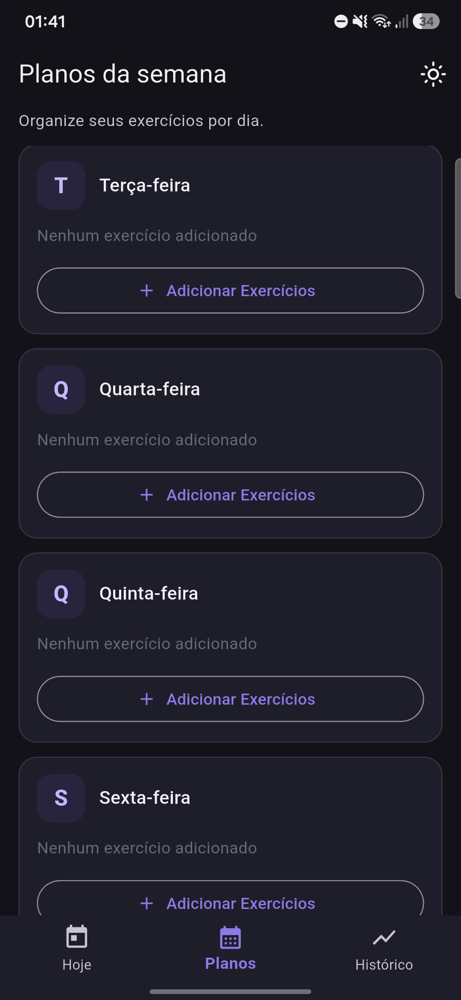
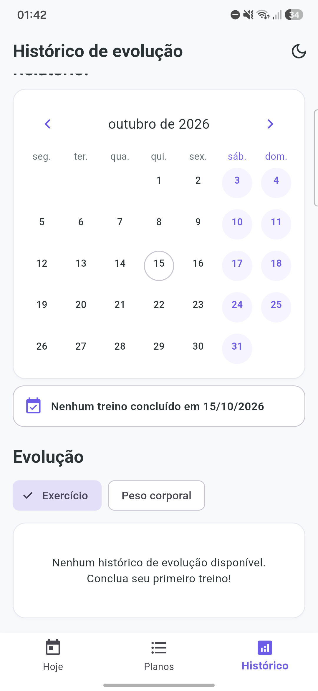
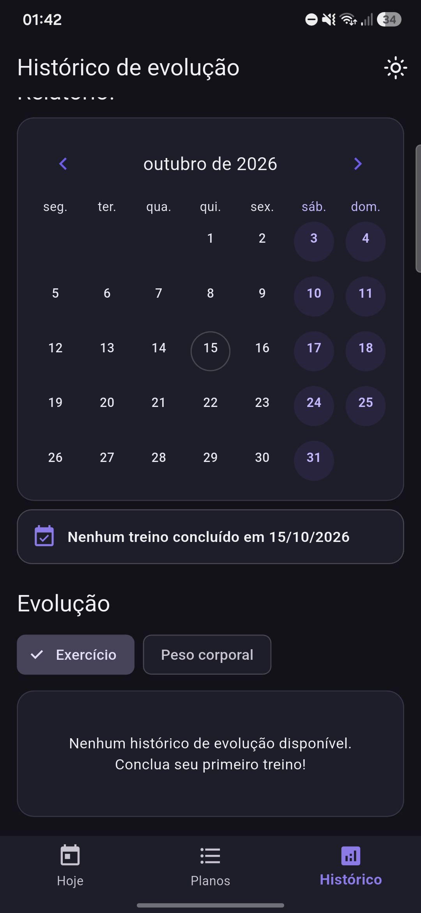
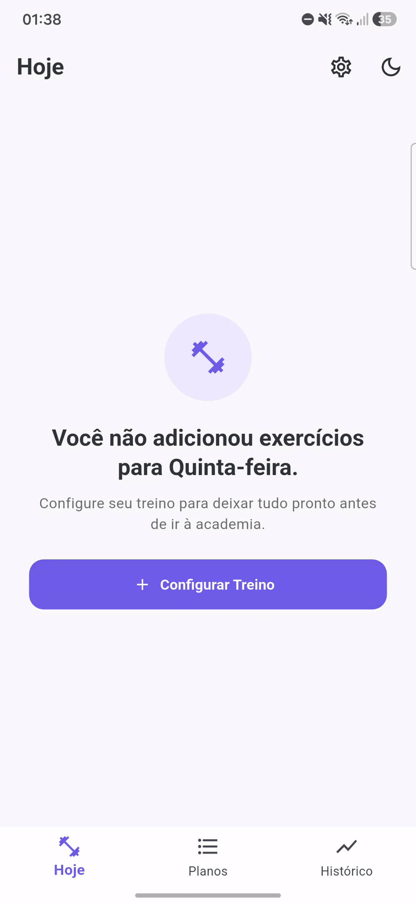

<div align="center"> 
  
 
# Offline Gym

### Seu treino organizado. Seus registros no seu aparelho. Sem depender de internet.

O **Offline Gym** é um aplicativo Android para planejar treinos, registrar séries e cargas e acompanhar a evolução — com foco em uma experiência simples e **offline-first**.

[📲 Baixar para Android](https://github.com/LuanThierry/offline-gym/releases/latest/download/Offline-Gym.apk) · [Ver versões](https://github.com/LuanThierry/offline-gym/releases) · [Código-fonte](https://github.com/LuanThierry/offline-gym)

[⭐ Apoiar a iniciativa com uma estrela](https://github.com/LuanThierry/offline-gym/stargazers)


</div>

---

## Por que criei este aplicativo?

O Offline Gym nasceu de uma necessidade minha: eu queria consultar meu planejamento e registrar o que realmente fazia durante o treino sem depender de uma conexão com a internet nem espalhar as informações por anotações diferentes.

Comecei construindo uma ferramenta para resolver esse problema na minha própria rotina. A ideia é direta: abrir o aplicativo na academia, conferir os exercícios do dia, registrar séries e cargas e depois consultar o histórico — inclusive quando a conexão não está disponível.

Com o tempo, o projeto também se tornou uma forma prática de desenvolver minhas habilidades com Flutter, Dart, persistência local, gerenciamento de estado e testes. Mas ele não existe apenas como exercício de programação: **a prioridade é ser útil no uso real**. Estou compartilhando o código e as versões Android para que outras pessoas possam experimentar, apontar problemas e sugerir melhorias.

## O que você pode fazer

- **Organizar a semana:** montar os treinos por dia e configurar exercícios, séries, repetições e carga de referência.
- **Registrar o treino:** marcar séries concluídas e anotar a carga usada em cada série.
- **Retomar uma sessão:** preservar o estado do treino em andamento para facilitar a continuidade após uma interrupção.
- **Consultar o histórico:** rever sessões concluídas, navegar pelas datas de treino e excluir registros lançados por engano.
- **Acompanhar a evolução:** visualizar gráficos de cargas por exercício e registrar, consultar e excluir o peso corporal separadamente.
- **Fazer backup:** exportar treinos, pesos e imagens para um arquivo `.zip` e importá-lo em outro aparelho, sem depender de nuvem.
- **Associar imagens aos exercícios:** selecionar fotos ou GIFs da galeria e mantê-los no armazenamento local do dispositivo.
- **Escolher a aparência:** usar tema claro, escuro ou o tema do sistema.
- **Usar sem conta:** as funções principais e os registros são mantidos localmente, sem exigir cadastro ou sincronização com um servidor.

> O projeto continua em evolução. A disponibilidade e o comportamento de cada recurso devem ser conferidos na versão instalada.


Interface real do aplicativo, nas versões clara e escura.

<table align="center">
  <tr>
    <td align="center" width="50%">
      <br>
      <sub><b>Hoje · claro</b></sub>
    </td>
    <td align="center" width="50%">
      <br>
      <sub><b>Hoje · escuro</b></sub>
    </td>
  </tr>
  <tr>
    <td align="center" width="50%">
      <br>
      <sub><b>Planos da semana · claro</b></sub>
    </td>
    <td align="center" width="50%">
      <br>
      <sub><b>Planos da semana · escuro</b></sub>
    </td>
  </tr>
  <tr>
    <td align="center" width="50%">
      <br>
      <sub><b>Histórico e evolução · claro</b></sub>
    </td>
    <td align="center" width="50%">
      <br>
      <sub><b>Histórico e evolução · escuro</b></sub>
    </td>
  </tr>
</table>
<hr>
<p align="center">
  
</p>

## Decisões de projeto

### Offline-first por escolha

Uma rotina de treino não deveria ficar inacessível porque a conexão caiu ou o sinal da academia é ruim. Por isso, os dados principais são armazenados localmente com SQLite. O aplicativo não depende de uma conta ou de um serviço remoto para consultar os registros existentes.

### Planejado não é o mesmo que realizado

A carga de referência de um exercício e a carga usada em uma série são informações diferentes. O aplicativo procura manter essa distinção para que seja possível ajustar o treino no momento da execução e registrar melhor o que foi feito.

### Histórico separado por finalidade

O histórico de treinos e o peso corporal representam informações diferentes. Mantê-los separados ajuda a consultar cada tipo de evolução sem misturar métricas.

### Construído para evoluir a partir do uso

O projeto é desenvolvido de forma incremental. Prefiro testar uma mudança, verificar seus efeitos e corrigir problemas identificados no uso em vez de tratar qualquer funcionalidade como pronta só porque o código compila.

## Tecnologias utilizadas

- **Flutter e Dart** — interface e lógica do aplicativo.
- **SQLite (`sqflite`)** — persistência local.
- **Provider** — gerenciamento de estado.
- **`shared_preferences`** — armazenamento da preferência de tema.
- **`image_picker`** — seleção de imagens da galeria.
- **`file_selector`** — seleção do arquivo de backup.
- **`archive`** — criação e leitura do arquivo `.zip` do backup.
- **`share_plus`** — compartilhamento do backup pelo menu do Android.
- **`path_provider`** — acesso às pastas de armazenamento do aplicativo.
- **`fl_chart`** — gráficos de evolução.
- **`table_calendar`** — calendário do histórico.
- **`flutter_launcher_icons`** — geração do ícone do aplicativo.

## Baixar e instalar no Android

1. Abra a página de [Releases](https://github.com/LuanThierry/offline-gym/releases).
2. Baixe o `Offline-Gym.apk` da versão mais recente. Esse arquivo é destinado a dispositivos Android ARM64, comuns em celulares atuais.
3. Abra o APK no aparelho e siga as instruções do Android. Talvez seja necessário autorizar a instalação de aplicativos obtidos dessa origem.
4. Abra o Offline Gym e confira se tudo funciona no seu dispositivo.

Também podem ser disponibilizadas variantes para outras arquiteturas na página de Releases. Escolha o arquivo compatível com seu aparelho.

### Sobre seus dados

Os registros são armazenados no próprio dispositivo, e o aplicativo não usa sincronização em nuvem.

Para trocar de aparelho, use **Configurações → Exportar backup** no aparelho antigo e envie o arquivo para o novo (Drive, WhatsApp, e-mail ou outro meio). No aparelho novo, use **Configurações → Importar backup**. A importação **substitui** os dados existentes naquele aparelho, então exporte um backup antes se houver algo a guardar.

Desinstalar o aplicativo ou limpar os dados dele pode remover os registros locais. Se os dados forem importantes, faça um backup antes dessas operações.

Se uma atualização não puder ser instalada por incompatibilidade de assinatura ou de versão, não desinstale a cópia atual sem antes exportar um backup.

## Executar o projeto localmente

Você precisa do Flutter SDK e de um ambiente configurado para executar aplicativos Android.

```bash
git clone https://github.com/LuanThierry/offline-gym.git
cd offline-gym
flutter pub get
flutter run
```

Para verificar o código e executar os testes:

```bash
flutter analyze
flutter test
```

Para gerar APKs Release separados por arquitetura:

```bash
flutter build apk --release --split-per-abi
```

Os arquivos são gerados em `build/app/outputs/flutter-apk/`. O arquivo `app-arm64-v8a-release.apk` é a variante ARM64.

## Estado do projeto

O Offline Gym é um projeto pessoal em desenvolvimento e está sendo compartilhado para uso e feedback. A análise estática, os testes automatizados e a compilação fazem parte do processo de validação, mas não garantem ausência de problemas em todos os aparelhos e versões do Android.

Se encontrar um comportamento inesperado, informe a versão do aplicativo e do Android e, se possível, os passos para reproduzir o problema.

## Feedback e contribuições

Encontrou um erro, tem uma sugestão ou quer propor uma melhoria?

- [Abrir uma Issue](https://github.com/LuanThierry/offline-gym/issues) para relatar um problema ou sugerir uma funcionalidade.
- Ao relatar um erro, inclua o que você fez, o que esperava que acontecesse e o que aconteceu de fato. Capturas de tela também ajudam.

### Se você apoia a iniciativa, deixe uma estrela ⭐

O Offline Gym começou como uma ferramenta para resolver uma necessidade da minha própria rotina. Se você acredita na ideia de criar software útil, simples e que respeita o uso offline, uma estrela no GitHub é uma forma pequena, mas importante, de apoiar o projeto e ajudar outras pessoas a encontrá-lo.

[⭐ Deixar uma estrela no repositório](https://github.com/LuanThierry/offline-gym/stargazers)

## Uso de inteligência artificial

Usei ferramentas de inteligência artificial como apoio em partes do planejamento, implementação, refatoração e investigação de erros. As sugestões foram tratadas como auxílio, não como garantia de correção: o código também foi analisado, testado e executado durante o desenvolvimento.

Para mim, esse processo faz parte do aprendizado de desenvolvimento de software: entender o problema, avaliar propostas, investigar erros e validar o resultado.

## Próximos passos

- Registrar repetições por série e marcar as séries feitas até a falha.
- Permitir editar sessões já salvas no histórico, corrigindo carga e repetições.
- Manter a evolução de cada exercício mesmo se o nome dele for alterado.
- Continuar testando a preservação dos dados e a retomada de sessões.
- Adicionar capturas de tela reais e atualizar a documentação conforme novas versões forem publicadas.
- Priorizar correções e melhorias a partir do uso e do feedback recebido.

## Licença

Uma licença de software ainda não foi definida. Até que isso aconteça, o repositório pode ser consultado publicamente, mas sua publicação não concede, por si só, permissão para redistribuir, modificar ou reutilizar o código. Entre em contato antes de presumir direitos de reutilização.

---

<div align="center">

Feito a partir de uma necessidade real, desenvolvido incrementalmente e compartilhado para evoluir com feedback.

</div>
